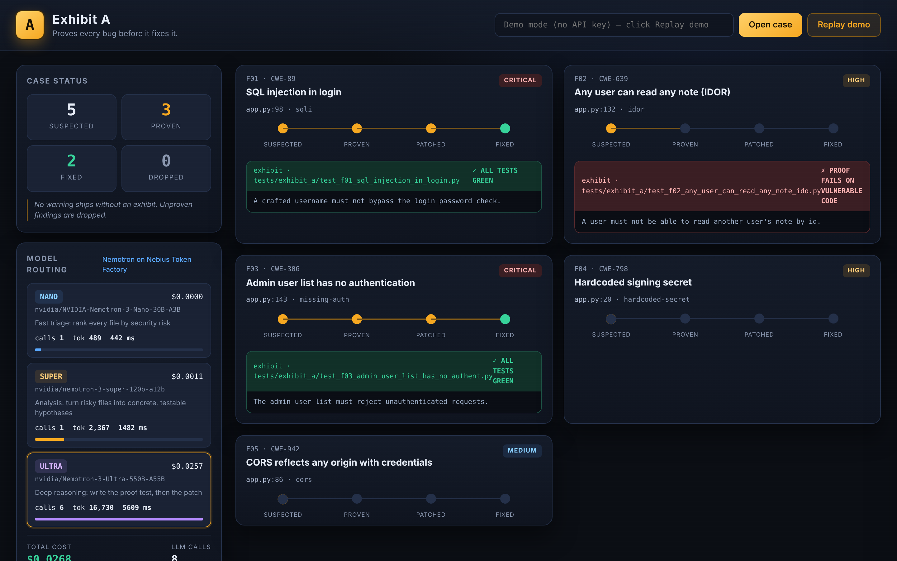

<div align="center">

# ⚖️ Exhibit A

### The security agent that **proves every bug before it fixes it.**

*No warning ships without an exhibit. If Exhibit A can't prove a bug with a failing test, it doesn't report it.*

Built for the **Nebius × NVIDIA Global AI Hackathon** · Coding & Agentic Engineering track
Powered by **NVIDIA Nemotron** on **Nebius Token Factory**


</div>

---

## The problem

In 2026, a huge share of new code is written by AI and shipped by people who can't fully review it. The result is a flood of apps with the same classic holes: missing auth checks, broken access control, hardcoded secrets, injectable queries, wide-open CORS.

The tools meant to catch this make it worse. Traditional scanners emit **hundreds of warnings**, most of them false positives, so developers learn to ignore all of them. A warning you can't trust is noise.

## The idea: proof, not warnings

Exhibit A is a coding agent that treats every suspected vulnerability like a case it has to **take to court**. For each one it:

1. **Writes a failing test that proves the bug is real** — e.g. *"an unauthenticated request to `/api/admin/users` returns `200` when it must return `401`."* That test is the evidence. The "Exhibit A."
2. **Runs that test in an isolated sandbox** and confirms it fails on the current code.
3. **Writes the smallest patch that fixes it**, then re-runs the proof *and the project's existing test suite* until the proof is green and nothing else broke.
4. **Produces a diff and a plain-English case file** you can drop into a pull request.

If it can't produce a reliable failing test, the finding is **dropped, not reported**. That single rule — *proof before patch* — is the whole product. The output is zero unproven findings and every fix verified by execution.



---

## What it does well — and its honest limits

**Strengths**
- **Execution-grounded, not vibes.** Every reported bug is backed by a test that actually ran and *failed* on the current code; every fix is re-verified against that test **and** the project's existing suite before it's called Fixed.
- **Cost-aware model routing.** Three Nemotron tiers on Token Factory, each used where it earns its keep — Nano for breadth, Ultra only for the hard reasoning. A full scan of the demo target cost **$0.13** on a real run.
- **A complete product, not a terminal demo.** The case-file UI shows each finding move Suspected → Proven → Fixed, the red proof test turning green, the generated test, and the diff — with a live model cost/latency panel.
- **It generalizes.** On a real run it surfaced a vulnerability we hadn't planted (unsalted password hashing) and *dropped* one it couldn't prove — the discipline working, not a scripted path.

**Honest limits (and what's next)**
- **Python targets today**; JS/TS and Go are the obvious next languages.
- **The Docker sandbox is the real isolation boundary.** The local fallback is network-free, env-scrubbed, and resource-limited (CPU/memory/file-size caps), but it's for development only — production runs use Docker.
- **Proof-before-patch costs one test run per finding**, so very large repos need batching and result caching. That's a deliberate trade: we spend compute to buy trust.

---

## Model routing — the right Nemotron for each job

Exhibit A sends each step to the cheapest Nemotron model that can do it well, all served on **Nebius Token Factory** through one OpenAI-compatible endpoint. The UI shows the live cost, token count, and latency per tier.

| Tier | Model (Token Factory ID) | Job in the pipeline | Why this tier |
|---|---|---|---|
| **Nano** | `nvidia/NVIDIA-Nemotron-3-Nano-30B-A3B` | Triage every source file by risk | Fast and nearly free; runs over the whole repo |
| **Super** | `nvidia/nemotron-3-super-120b-a12b` | Turn risky files into concrete, testable findings | Strong analysis at a fraction of Ultra's cost |
| **Ultra** | `nvidia/Nemotron-3-Ultra-550b-a55b` | Write the proof test, then write the patch | Hard multi-step reasoning where correctness matters most |

> The expensive model is only used for the two hardest steps, so a full scan of a small repo costs a few cents. Confirm the exact IDs your account serves with `python -m exhibit_a models`.

---

## Architecture

```
                         ┌─────────────────────────────────────────────┐
  repo / local dir  ───▶ │  CLONE → copy into an isolated workdir        │
                         └─────────────────────────────────────────────┘
                                          │
        NANO   ─────────────▶   1. TRIAGE   rank files by security risk
        SUPER  ─────────────▶   2. ANALYZE  risky file → concrete findings
                                          │   (each finding is just a hypothesis)
        ULTRA  ─────────────▶   3. PROVE    write a test asserting secure behaviour
                                          │
                    ┌─────────────────────▼─────────────────────┐
                    │  SANDBOX: run pytest (Docker, no network,  │
                    │  dropped caps / mem+cpu caps; local        │
                    │  subprocess fallback with scrubbed env)    │
                    └─────────────────────┬─────────────────────┘
                              test FAILS? ─┤─ no ─▶  DROP (unproven, never reported)
                                     yes   │
                                           ▼  finding is now PROVEN
        ULTRA  ─────────────▶   4. PATCH   smallest fix; re-run proof + full suite
                                           ▼
                              proof green + suite green ─▶  VERIFIED  (diff + case file)
```

Every event streams to the UI over Server-Sent Events, so you watch the case build in real time.

### Safety by design
Exhibit A is a **defensive** tool that runs on code you own. It never attacks a live system: tests run against a local copy in a sandbox with **no network access**. Proof payloads are minimal and only exercise the local code path (a classic auth-bypass check, an out-of-scope id, an untrusted `Origin` header). It finds and fixes; it does not weaponize.

---

## Quickstart

```bash
git clone https://github.com/Peri2505/exhibit-a
cd exhibit-a
pip install -r requirements.txt

cp .env.example .env            # add your NEBIUS_API_KEY
python -m exhibit_a models      # confirm the Nemotron model IDs your account serves

# (recommended) build the sandbox image for isolated test runs
docker build -t exhibit-a-sandbox:latest -f sandbox.Dockerfile .

# open the case-file UI
python -m exhibit_a serve       # → http://127.0.0.1:8000
```

Then either paste a path / public GitHub URL and click **Open case**, or click **Replay demo** to watch a recorded run against the bundled vulnerable app (no API key needed).

From the command line:

```bash
python -m exhibit_a scan --local ./demo_target          # scan the bundled target
python -m exhibit_a scan --repo https://github.com/you/project
```

### The bundled target
`demo_target/` is **NoteVault**, a tiny Flask API that is intentionally vulnerable (five planted bugs). It's the safe, self-contained thing to point Exhibit A at first. A recorded run of all five being proven and fixed lives in `runs/demo/` and drives the **Replay demo** button and the video.

---

## What runs where (Nebius & NVIDIA)

- **NVIDIA Nemotron** (Nano / Super / Ultra) does all the reasoning — triage, analysis, proof-test authoring, and patching.
- **Nebius Token Factory** serves every model behind one OpenAI-compatible endpoint (`/v1/chat/completions`), which is what makes the three-tier routing a few lines of config instead of three integrations.
- The sandbox and UI are plain Python; nothing is tied to a specific host, so you can run the agent anywhere and point it at Token Factory.

## Feedback for Nebius Token Factory & NVIDIA
See [`FEEDBACK.md`](FEEDBACK.md) for notes on the developer experience — what worked well and what tripped us up while building on Token Factory and Nemotron.

## Built during the submission period
Exhibit A was built from scratch for this hackathon. Everything in this repository — the agent, the three-tier Nemotron routing, the sandbox, the case-file UI, and the bundled vulnerable target — was written during the submission period.

## License
[MIT](LICENSE) — see the top of the file.
